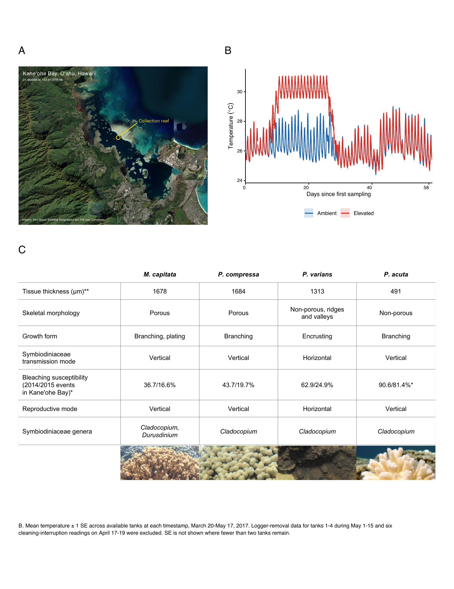

## Figure ownership and inputs

This is the official Figure 1 assembly notebook. Temperature preparation and the
Figure 1B plot belong to `ACE21_Sensor data.Rmd` and its shared plotting script,
not the physiology notebook. The map and trait table are assembled here by
`scripts/build_figure1.py`. Run from the project root.

- **A:** cached satellite imagery, attribution and georeferencing metadata in
  `Figures/assets/Fig1/`; collection coordinates 21.463086, -157.812518.
- **B:** investigator-approved temperature means ± SE across tanks, with elapsed
  days since first sampling (day 0 = March 20, 2017). Logger-removal exclusions
  and missing-record handling are documented in the sensor workflow.
- **C:** source trait values and extracted coral photos. Scientific names are
  italicized. Keep `*` and `**` until actual reference numbers are supplied.
  The reproductive-mode row and source footnotes remain flagged for author review.

## Build and export Figure 1B

Use the same implementation as the sensor notebook; do not duplicate methods.
This refreshes derived input tables if needed, prints the plot, and exports PDF,
PNG and editable RDS versions. Raw source files remain untouched.

```{r figure-1b-export, fig.width=11, fig.height=5.5}
source("scripts/plot_apex_temperature.R")
```

## Import panels and assemble Figure 1

The Python assembly imports the exported B PDF as vector graphics. This step
only assembles the panels, so the temperature script is not rerun a second time.
Python needs openpyxl, reportlab and pypdf; Poppler supplies pdftoppm for the PNG.
Set `FIGURE1_PYTHON` if the automatic Python selection is unsuitable.

```{r figure-1-assembly}
figure1_status <- system2(figure1_python(),
  c(shQuote("scripts/build_figure1.py"), "--assemble-only"))
stopifnot(figure1_status == 0L, file.exists("Figures/Fig1.pdf"),
          file.exists("Figures/Fig1.png"))
```

```{r figure-1-preview, echo=FALSE, out.width="100%"}

```

Outputs: `Figures/Fig1.pdf` and `Figures/Fig1.png`.
